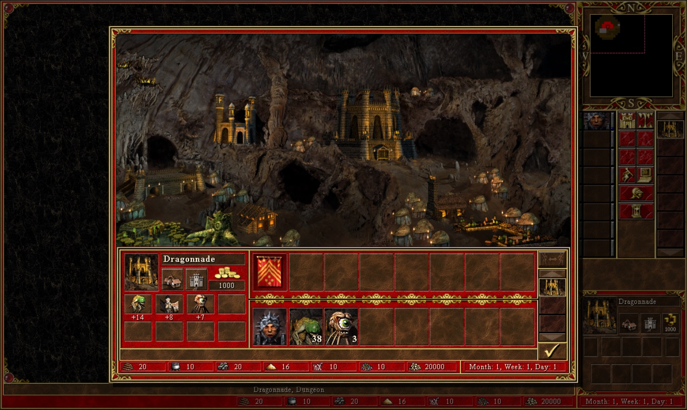
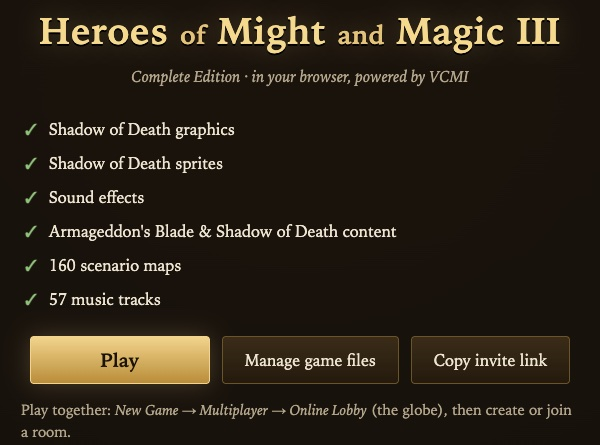

# Heroes of Might and Magic III in the browser

Play **Heroes of Might and Magic III Complete** in a browser tab: single scenarios, campaigns,
random maps, hot-seat and **online multiplayer with your friends**, on Windows, macOS, Linux,
iPad or phone, with nothing to install.

It is the open-source [VCMI](https://vcmi.eu) engine compiled to WebAssembly, plus a small
server that one person in your group runs to bring everyone together.



> [!IMPORTANT]
> This project contains no game assets. Every player needs their own copy of Heroes III Complete
> (for example from [GOG](https://www.gog.com/game/heroes_of_might_and_magic_3_complete_edition)).

## Who does what

| You are... | You need | Start here |
| --- | --- | --- |
| **A player** | A browser and a link from your lobby master | [Playing](docs/playing.md) |
| **A lobby master**: you run the server for your group | A computer that is on while you play, and the game | [Hosting](docs/hosting.md) |
| **A developer** | macOS or Linux, some patience for the first build | [Building](docs/building.md), [Architecture](docs/architecture.md), [Contributing](CONTRIBUTING.md) |

## Highlights

- **The full game**: Restoration of Erathia, Armageddon's Blade and Shadow of Death scenarios and
  campaigns, random maps, hot-seat, the VCMI interface improvements and AI.
- **Online multiplayer without port forwarding**: everyone meets in the lobby on your server, and
  each match runs inside the host player's browser.
- **One link for friends**: the lobby master can offer their game files, so players who own the
  game don't have to find and copy the installation folder (useful on phones and tablets).
  The files are downloaded once (about 360 MB) into the browser's private storage.
- **Easy to host**: Docker Compose on Windows, macOS or Linux, or a Linux/WSL service, and an HTTPS
  address for your friends through [Tailscale](https://tailscale.com) or
  [Cloudflare Tunnel](https://developers.cloudflare.com/cloudflare-one/connections/connect-networks/), both free.

## Quick start

**Lobby master**, with [Docker](https://docs.docker.com/get-started/get-docker/) installed:

```sh
curl -fsSLO https://github.com/mihaicristianfarcas/homm3-browser/releases/latest/download/homm3-browser.tar.gz
tar -xzf homm3-browser.tar.gz && cd homm3-browser
cp .env.example .env            # optional: set HOMM3_DIR and GAMEDATA_KEY to offer your game files
docker compose --profile quick-tunnel up -d --build
docker compose logs quick-tunnel | grep trycloudflare.com
```

The address appears in the log after a few seconds. Send your friends that `https://….trycloudflare.com`
address, followed by `/?key=<your GAMEDATA_KEY>`
if you offer the game files. That address is temporary; [Hosting](docs/hosting.md) shows how to get a
permanent one and every other option, step by step.

**Players**: open the link, wait for the one-time download (or pick your own Heroes III folder),
press **Play**. To play together: *New Game → Multiplayer → Online Lobby* (the globe).



## Browser support

| Browser | |
| --- | --- |
| Chrome, Edge, Brave and other Chromium browsers | Supported |
| Firefox | Supported |
| Safari 17 or newer, on Mac, iPhone and iPad | Supported |

The page must be opened over **HTTPS** (or as `localhost`): browsers only allow the WebAssembly
threads the game needs on secure pages. The hosting guide sets this up for you.

## Limitations

- No cutscene videos: the intro and campaign videos are skipped.
- LAN games by IP address (*Host* / *Join*) are not available, because browsers can't open network
  ports. Use the Online Lobby instead; it works on a local network too.
- Horn of the Abyss content is not supported.
- Phones work, but have little memory for large maps; a computer or tablet is more comfortable.
- Saved games and the downloaded files live in the browser, separately for every address the game
  is opened from.

## How it works

```
 player's browser tab                                          lobby master's computer
┌───────────────────────────────────────────────┐            ┌──────────────────────────────┐
│ page: launcher, input, audio, WebSockets       │◄── HTTPS ─►│ web server (server/)         │
│ worker: VCMI client + game server (host only)  │            │  ├ the game and launcher     │
│   ├ renders to an OffscreenCanvas (WebGL)      │            │  ├ game files (with a key)   │
│   ├ AI and helper threads                      │            │  └ /net/lobby ⇄ TCP ─────────┼─► VCMI lobby
│   └ files in the browser's private storage     │            └──────────────────────────────┘
└───────────────────────────────────────────────┘
```

The VCMI client, its in-process game server and the AIs are compiled to WebAssembly with
Emscripten and run in a worker thread. Network connections are WebSockets that the web server
bridges to the native VCMI lobby. Details are in [Architecture](docs/architecture.md).

## Repository

| Path | |
| --- | --- |
| `vcmi/` | VCMI 1.7.5 with the browser port ([UPSTREAM.md](UPSTREAM.md); `git diff` against the first commit shows every change) |
| `web/` | Launcher page: browser checks, game files, starting the game |
| `server/` | Web server with the headers WebAssembly threads need, game file downloads and the lobby bridge |
| `deploy/`, `compose.yaml`, `Dockerfile` | Server installation: Linux/WSL services, Docker, Cloudflare quick tunnels |
| `scripts/` | Building, running locally, packaging releases, deploying to a Windows PC |
| `patches/` | SDL2 patch so SDL can render and play audio from a worker |
| `tests/` | Browser automation for Chromium, Firefox and Safari, server smoke test |

## Credits

- [VCMI](https://github.com/vcmi/vcmi) and its contributors, who rebuilt Heroes III as an open
  engine; this project only makes it run in browsers.
- [Emscripten](https://emscripten.org), [SDL](https://libsdl.org), Boost and oneTBB.
- New World Computing and 3DO, for the game we still play 25 years later.

## License

GPL-2.0-or-later, the same as VCMI; see [LICENSE](LICENSE). Heroes of Might and Magic is a
trademark of Ubisoft. This project is not affiliated with or endorsed by Ubisoft. Only share game
files with people who own the game.
